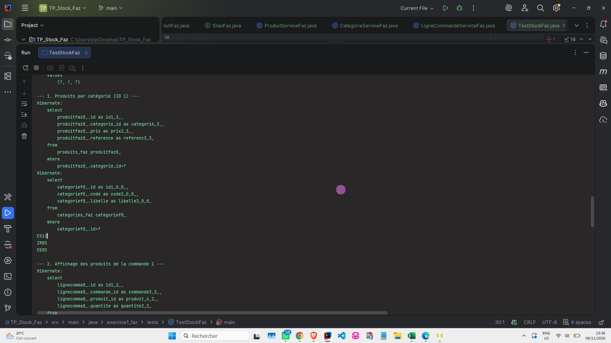
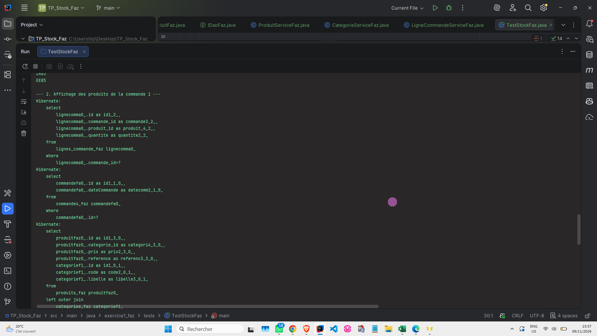
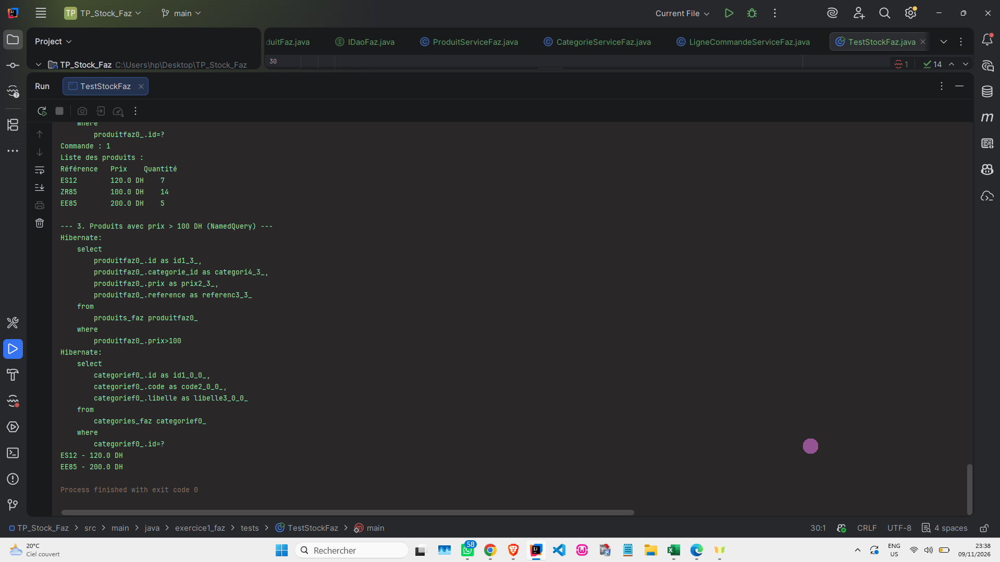
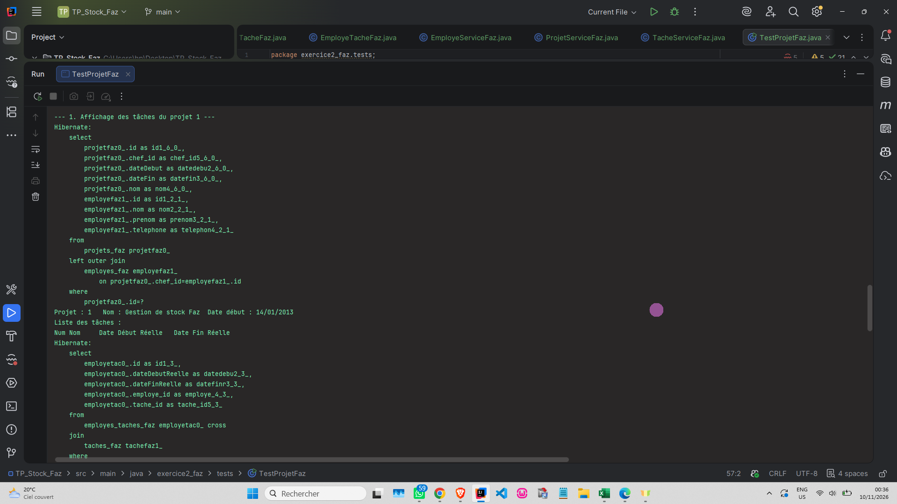
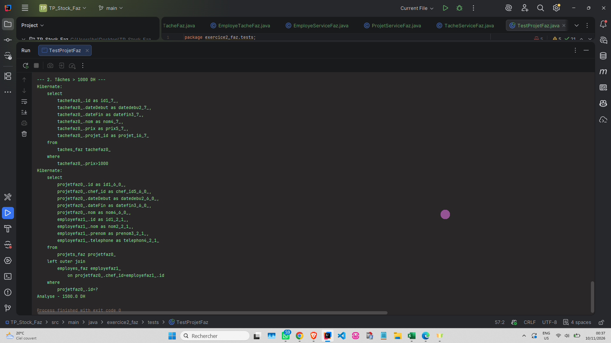
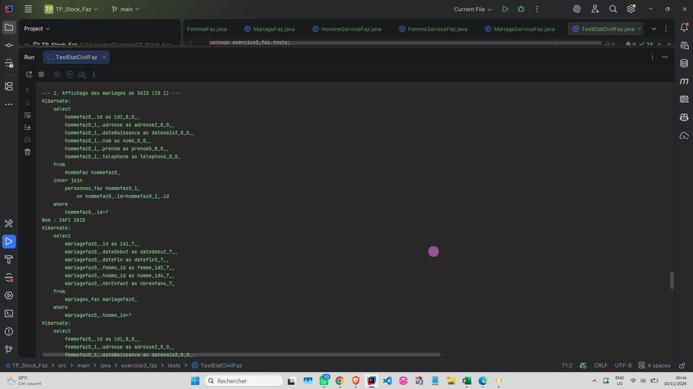
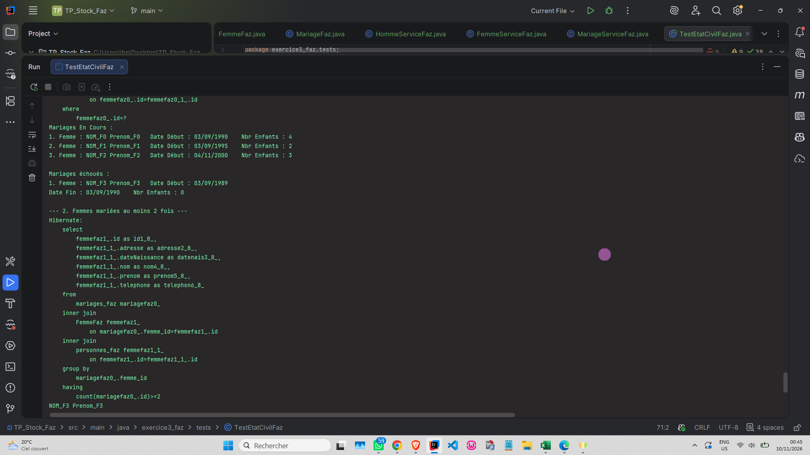
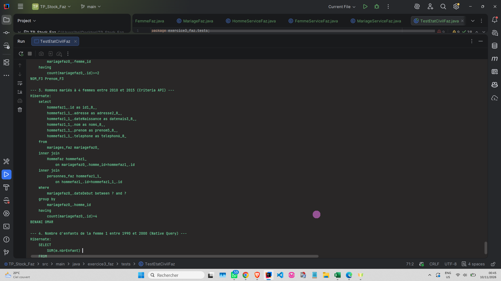
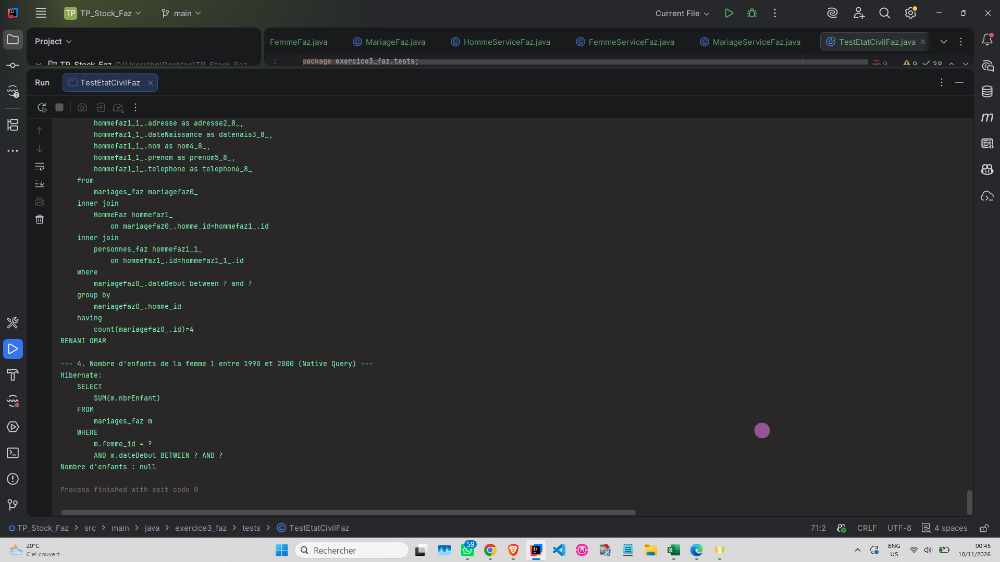

# TP Hibernate - Gestion Globale (Version Faz)

## 📌 Présentation du Projet
Ce projet regroupe **3 exercices distincts** réalisés dans le cadre d'un TP sur Hibernate et JPA. Il illustre la mise en place d'une architecture en couches (Entités, DAO, Services) avec une gestion rigoureuse des transactions, des tests unitaires et des requêtes avancées.

Afin de garantir l'unicité de ce travail, l'ensemble des classes, tables et méthodes portent le suffixe **`Faz`**.

---

## 🛠️ Technologies Utilisées
*   **Langage :** Java 23
*   **ORM :** Hibernate 5.6.15.Final (JPA)
*   **Base de données :** MySQL 8.0
*   **Gestionnaire de dépendances :** Maven
*   **Outil d'analyse :** SonarQube (IntelliJ)

---

## 📸 Captures d'écran et Explications

### 📦 Exercice 1 : Application de gestion de stock
*Modélisation d'une relation Many-to-Many avec une table de jointure porteuse de données (quantité).*

**1. Création de la base et insertion**

*Commentaire :* Cette capture montre l'exécution du `TestStockFaz`. Hibernate crée automatiquement les tables (`categories_faz`, `produits_faz`, `commandes_faz`, `lignes_commande_faz`) et insère les données de test.

**2. Résultats des requêtes HQL**

*Commentaire :* Affichage des produits de la commande 1 au format demandé (Référence, Prix, Quantité) grâce à une requête HQL avec jointure. Le test de la requête nommée (prix > 100 DH) est également validé.

**3. Détails supplémentaires**

*Commentaire :* Vérification des résultats de la liste des produits par catégorie et de l'exécution globale sans erreur (`Process finished with exit code 0`).

---

### 📦 Exercice 2 : Application de gestion de projets
*Modélisation de relations Many-to-Many avec dates réelles (EmployeTache) et d'une relation d'auto-référence (Chef de projet).*

**1. Création des entités et insertion**

*Commentaire :* Insertion réussie d'un employé, d'un projet, de tâches et de la liaison avec les dates réelles. Les logs SQL prouvent le bon mapping des clés étrangères (`chef_id`, `projet_id`).

**2. Affichage des tâches d'un projet**

*Commentaire :* La méthode `afficherDetailsProjetFaz` affiche exactement le tableau attendu par l'énoncé avec les dates de début et de fin réelles. Le test de la requête nommée (tâches > 1000 DH) fonctionne parfaitement.

---

### 📦 Exercice 3 : Application de gestion de l'état civil
*Modélisation d'un héritage (`JOINED`) et utilisation de l'API Criteria et de requêtes natives.*

**1. Héritage et insertions**

*Commentaire :* On voit clairement la stratégie d'héritage en action : une table `personnes_faz` (classe mère) et des tables `HommeFaz` / `FemmeFaz` (classes filles) liées par leur ID.

**2. Affichage des mariages (Mariages en cours vs échoués)**

*Commentaire :* La méthode `afficherDetailsMariagesHommeFaz` respecte scrupuleusement le format de l'énoncé. Elle sépare les mariages en cours (sans date de fin) des mariages échoués (avec date de fin).

**3. Requêtes HQL avancées et API Criteria**

*Commentaire :* Résultats de deux requêtes complexes :
- La liste des femmes mariées au moins 2 fois (via `GROUP BY` et `HAVING`).
- La liste des hommes mariés à 4 femmes entre deux dates (via l'**API Criteria** de JPA).

**4. Requête Native (SQL pur)**

*Commentaire :* Test de la requête `createNativeQuery` pour calculer la somme des enfants d'une femme sur une période donnée.

---

## 🚀 Comment exécuter le projet
1. Assurez-vous que **MySQL** est lancé sur le port 3306 (identifiant : `root`, sans mot de passe).
2. Chargez les dépendances Maven (`Reload Maven Project`).
3. La base de données `db_stock_faz` sera automatiquement créée par Hibernate au premier lancement.
4. Exécutez les classes de test situées dans `src/main/java` :
    - `exercice1_faz.tests.TestStockFaz`
    - `exercice2_faz.tests.TestProjetFaz`
    - `exercice3_faz.tests.TestEtatCivilFaz`